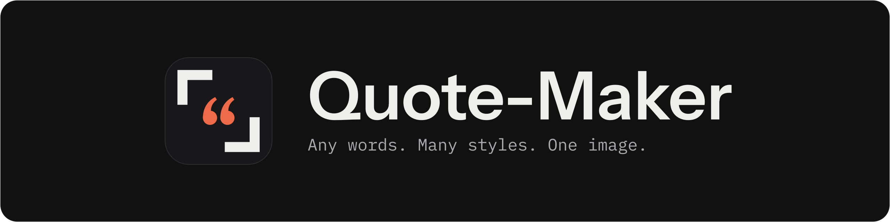
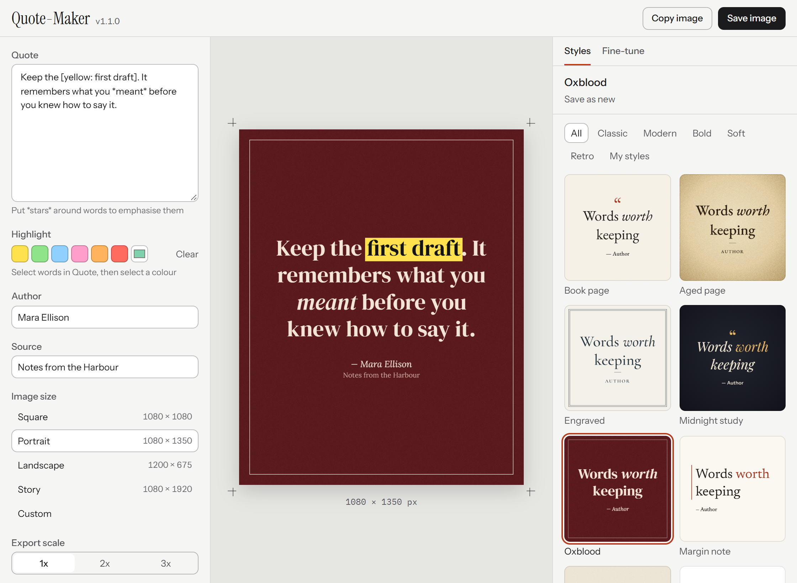
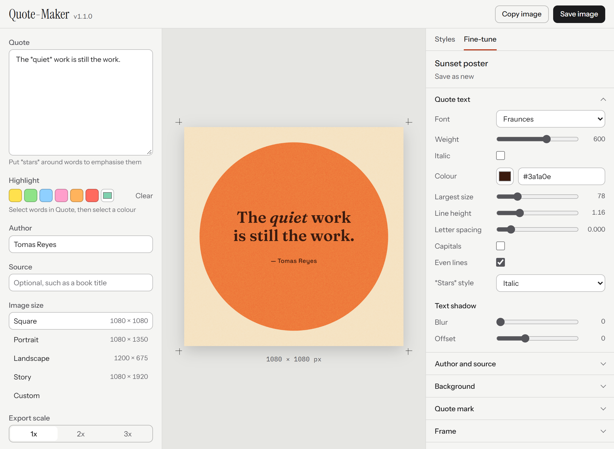
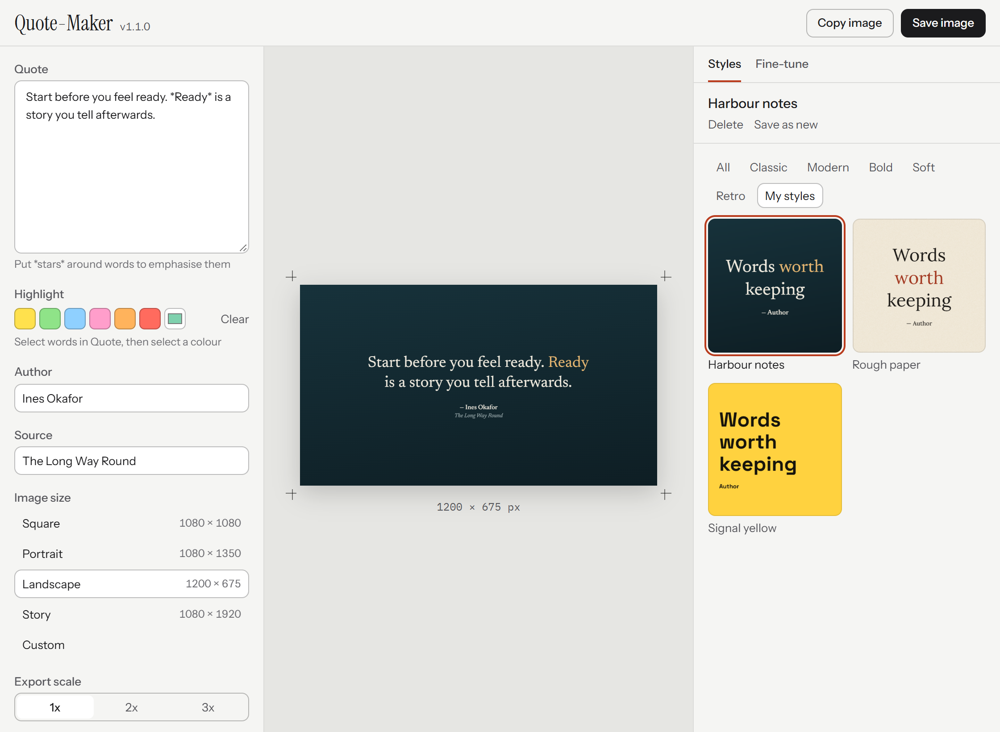

Quote-Maker turns pasted text into a quote image. Select a style, adjust it, and save a PNG. Works offline. Sends no data.

Try the working demo on the [Quote-Maker website](https://tariqmk.github.io/Quote-Maker/).

<picture>
  <source media="(prefers-color-scheme: dark)" srcset="assets/screenshots/editor-dark.png">
  
</picture>

## Features

- 25+ preset styles in 5 categories: Classic, Modern, Bold, Soft and Retro.
- Highlights behind selected words, in 6 preset colours or a custom colour.
- Fine-tune controls for text, author and source, background, quote mark, frame and layout.
- Custom styles that you save, update and delete.
- 24 bundled font families.
- 5 image sizes and 3 export scales.
- Text that shrinks automatically to fit the image.
- Portable: your styles and work stay in one folder beside the app.

## Download

1. Open the [Releases page](https://github.com/TariqMK/Quote-Maker/releases).
2. Download the file for your computer:
   - Windows x64: `.exe`
   - macOS Apple Silicon: `.zip`
   - Linux x64: `.tar.gz`
3. Put the app in a folder you can change, such as a folder on a USB drive. Do not use `Program Files`.
4. Open the app. No installation is necessary on Windows.

**Note:** The builds are not signed.

- **Windows:** SmartScreen can show a warning. Select **More info**, then **Run anyway**.
- **macOS:** Unzip the file. Move the app out of `Downloads` with Finder before you open it, because macOS can run a downloaded app from a read-only location. To approve the first start, go to **System Settings > Privacy & Security** and select **Open Anyway**. Intel Macs are not supported.
- **Linux:** Install WebKitGTK first. On Ubuntu 24.04, run `sudo apt install gir1.2-webkit2-4.1`.

## Make a quote image

1. Paste your text into **Quote**.
2. Optional: enter **Author** and **Source**. Empty fields do not appear in the image.
3. Select a style in the **Styles** tab.
4. Select an **Image size**.
5. Optional: select an **Export scale**. A scale of 2x makes an image of 2160 x 2700 px from a size of 1080 x 1350 px.
6. Select **Save image** (Ctrl+S), or select **Copy image**.

## Quote text

- To emphasise words, put stars around them: `the *best* time`. The style sets the emphasis to italic, bold or colour.
- Quote marks around the whole pasted text are removed. The style adds its own quote mark.
- Straight quotes, `--` and `...` change to typographic characters.
- A line break stays in the image. A blank line adds a gap.

**Note:** The bundled fonts contain Latin characters only. Other alphabets use the fonts installed on your computer, so they can look different on another computer.

## Highlight words

1. Select words in **Quote**.
2. Under **Highlight**, select a colour: yellow, green, blue, pink, orange or red. To use another colour, select the custom colour box.

The app adds a mark to the text, such as `[yellow: these words]` or `[#7fd1ae: these words]`. You can also type a mark or delete it. The mark does not appear in the image.

- To change a colour, select the words again, then select the new colour.
- To remove a highlight, select the words, then select **Clear**.
- Highlights work in **Quote** only. **Author** and **Source** do not have them.
- The text keeps the style's colour when it is readable on the highlight. If it is not readable, the text changes to near-black or white.
- A highlight removes the style's text shadow from those words.

## Image sizes

| Image size | Pixels |
|---|---|
| Square | 1080 x 1080 |
| Portrait | 1080 x 1350 |
| Landscape | 1200 x 675 |
| Story | 1080 x 1920 |
| Custom | 200 to 6000 per side |

The caption below the preview shows the image size. It also shows when the text was reduced to fit.

## Custom styles

<picture>
  <source media="(prefers-color-scheme: dark)" srcset="assets/screenshots/fine-tune-dark.png">
  
</picture>

1. Select a style in the **Styles** tab.
2. Open the **Fine-tune** tab and change the controls.
3. Select **Save as new**.
4. Enter a name, then select **Save style**.

The style appears under **My styles**.

<picture>
  <source media="(prefers-color-scheme: dark)" srcset="assets/screenshots/my-styles-dark.png">
  
</picture>

- To save more changes to a custom style, select **Update**.
- To undo changes since the last save, select **Reset**.

**Caution:** **Delete** removes a custom style permanently. The app asks you to confirm first.

## Move the app

The app is portable. It keeps your custom styles and your last quote and settings in a folder named `Quote-Maker Data`, beside the app. The app makes this folder when it first saves something.

1. Close the app.
2. Move the app and the `Quote-Maker Data` folder together to the new location.
3. Open the app.

**Note:** If the app cannot write to the folder, it shows a message at the top of the window and your changes are not saved. Move the app to a folder you can change.

## Privacy

- The app works offline.
- The app has no telemetry, analytics or tracking.
- The app makes no network connections. The window loads its interface from a local server on your own computer (127.0.0.1). A content security policy blocks all other network requests.
- Images are saved only where you select.
- Custom styles and your last quote and settings stay in the `Quote-Maker Data` folder beside the app. The app keeps your data in no other place.
- While it runs, the app and its window use temporary working files in your system's temporary folder. They hold none of your saved styles, and they are normally removed when the app closes.
- The website is separate from the app. Its demo sets your text in your browser and does not send it. The website makes one outside request, to the GitHub API, to find the latest release. GitHub can see your IP address when your browser makes this request. The website has no analytics or tracking.

## Run From Source

You need Python 3.10 or later. Node.js is necessary for the JavaScript tests only.

1. Create the environment: `python -m venv .venv`
2. Install the dependencies: `.venv\Scripts\python -m pip install -e .[dev]`
3. Start the app: `.venv\Scripts\python -m quote_maker`

On macOS and Linux, use `.venv/bin/python`. On Linux, also install the system packages in `.github/workflows/release.yml`, then run `pip install pycairo PyGObject`.

A source run shows the version `v0.0.0.dev0`. It keeps its data in a git-ignored `Quote-Maker Data` folder in the project folder.

## Tests

Run all tests:

```bash
.venv\Scripts\python -m pytest
```

## Update the Screenshots

The script needs Microsoft Edge. It uses made-up sample data only. The version label shows the newest version tag in the repository.

1. Install the brand tools: `.venv\Scripts\python -m pip install -e .[brand]`
2. Retake the screenshots: `.venv\Scripts\python assets/make_screenshots.py`
3. To rebuild the icon, banner and social card, run: `.venv\Scripts\python assets/make_assets.py`

## Update the Website

The website is in the `docs` folder. GitHub Pages serves it from `main`. The demo uses copies of the app's renderer, presets and fonts.

**Note:** Do not edit the files in `docs/engine`. The script replaces them.

1. Change the renderer, presets, fonts or brand images in their usual folders.
2. Refresh the copies: `.venv\Scripts\python assets/make_site.py`
3. Preview the website: `.venv\Scripts\python -m http.server 8766 --bind 127.0.0.1 --directory docs`
4. Open `http://127.0.0.1:8766` in a browser.
5. Push your changes to `main`.

The page finds download files by the end of their names, such as `windows-x64.exe`. If you rename the release files, the buttons open the Releases page instead.

## Creating a Release

1. Push your changes to `main`.
2. On GitHub, open **Actions > Release > Run workflow**.
3. Keep the branch set to `main`. The workflow does nothing on other branches.
4. Select a **Release type**:
   - `draft`: creates a draft GitHub release with all files attached. It is not public until you publish it.
   - `public`: creates a published GitHub release.
5. Select a **Version change**: `patch`, `minor` or `major`.
6. Select **Run workflow**.

The workflow runs the tests, then builds for Windows x64, macOS Apple Silicon and Linux x64. It creates the tag and release only after all three builds succeed.

- **Version:** The workflow finds the highest `vX.Y.Z` in the git tags and GitHub releases, including drafts, and then increases it. For example, a patch release after `v1.0.0` is `v1.0.1`.
- **Source version:** The workflow applies the version on the build machine. It never commits or pushes to a branch.
- **Release notes:** GitHub generates them. Replace them with your own before you publish.
- **Secrets:** None are necessary. The workflow uses the token that GitHub provides.

## Licence

Quote-Maker is licensed under the [GNU General Public License v3.0](LICENSE).

The bundled fonts keep their own open licences. Each licence is in the font's folder in `quote_maker/web/fonts` and `docs/engine/fonts`.
