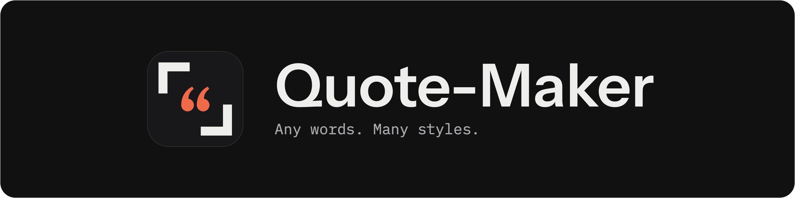
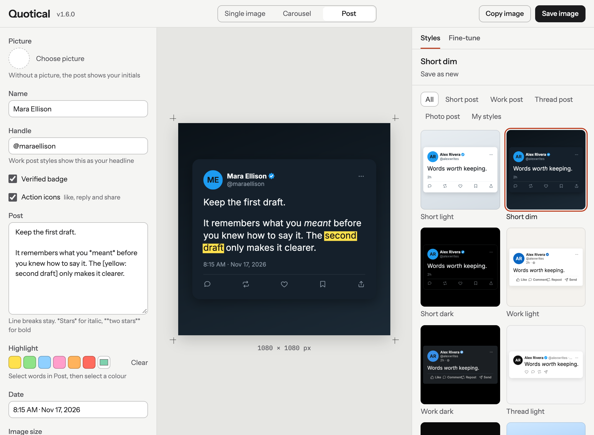
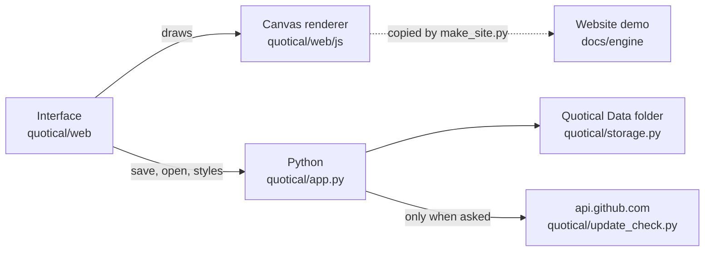

Paste any text and save it as a styled quote image, a social media post image or a carousel of slides. Works offline. No tracking.

**Contents:** [What it does](#what-it-does) · [Privacy](#privacy) · [Download](#download) · [How to use](#how-to-use) · [For developers](#for-developers)

<picture>
  <source media="(prefers-color-scheme: dark)" srcset="assets/screenshots/editor-dark.png">
  
</picture>

## What it does

Quotical has three modes: **Single image**, **Carousel** and **Post**. Select a style, adjust it, and save PNG or JPG files. To try it first, use the working demo on the [Quotical website](https://tariqmk.github.io/Quotical/).

### Quote images

A pasted quote becomes a finished image in one click. Select from 25+ styles in 5 categories: Classic, Modern, Bold, Soft and Retro. The text shrinks to fit the image, and 24 bundled font families come with the app.

### Carousels

<picture>
  <source media="(prefers-color-scheme: dark)" srcset="assets/screenshots/carousel-dark.png">
  
</picture>

A long article becomes a numbered set of slides. The text splits into slides automatically, or where you add a slide break. **Save all slides** puts every slide in a new folder. There are 6 carousel styles.

### Post images

<picture>
  <source media="(prefers-color-scheme: dark)" srcset="assets/screenshots/post-dark.png">
  
</picture>

Your words look like a social media post. Each post shows your picture or initials, name, handle, verified badge and date. There are 10 post styles in 4 layouts: Short post, Work post, Thread post and Photo post. The images show no platform logos.

### Highlights

The words that matter stand out. Put a band behind selected words in 6 preset colours or a custom colour. The text stays readable on the band. To mark every line, like a highlighter pen on a book page, use the **Highlighted page** style.

### Fine-tune and custom styles

<picture>
  <source media="(prefers-color-scheme: dark)" srcset="assets/screenshots/fine-tune-dark.png">
  
</picture>

Any style can become your own. Change the text, background, frame and layout in each mode. Backgrounds include paper grain and a book page with faint text showing through. Save the result under **My styles**, then update or delete it later.

<picture>
  <source media="(prefers-color-scheme: dark)" srcset="assets/screenshots/my-styles-dark.png">
  
</picture>

### Portable

Everything stays in one folder beside the app. Move the two together, for example to a USB drive, and your styles and work move too.

## Privacy

- The app works offline.
- The app has no accounts, telemetry, analytics or tracking.
- The app makes one connection to the internet, and only when you ask. When you select the version number, the app asks GitHub (api.github.com) for the latest release. It sends nothing else and downloads nothing. The app does not keep the answer.
- **Report a Problem…** opens a page on GitHub in your browser. Nothing is sent until you submit it there. The page gets only the app's version and your system's name, such as `macOS 26.1`.
- The app window loads only from your own computer (127.0.0.1). The window is blocked from all connections to the internet.
- Images and slide folders are saved only where you select.
- The app reads a text file only when you select **Open text file**. It does not change the file.
- The app reads a picture only when you select **Choose picture**. It does not change the file. A small copy of the picture stays with your saved work in the `Quotical Data` folder.
- Custom styles and your last work and settings stay in the `Quotical Data` folder beside the app. The app keeps your data in no other place.
- While it runs, the app uses temporary working files in your system's temporary folder. They hold none of your saved styles. They are normally removed when the app closes.
- The website is separate from the app. Its demo sets your text in your browser and does not send it. The website makes one outside request, to GitHub (api.github.com), to find the latest release. GitHub can see your IP address when your browser makes this request. The website has no analytics or tracking.

## Download

Quotical is free. It runs on 64-bit Windows, Macs with Apple Silicon, and 64-bit Linux.

1. Open the [Releases page](https://github.com/TariqMK/Quotical/releases).
2. Download the file for your computer:
   - Windows: the `.exe` file
   - macOS: the `.zip` file
   - Linux: the `.tar.gz` file
3. Put the app in a folder you can change, such as a folder on a USB drive. Do not use `Program Files`.
4. Open the app. No installation is necessary.

**Note:** The app is not signed.

- **Windows:** SmartScreen can show a warning. Select **More info**, then **Run anyway**.
- **macOS:** Unzip the file. Move the app out of `Downloads` with Finder before you open it, because macOS can run a downloaded app from a read-only location. Then follow "Opening on macOS" below. Intel Macs are not supported.
- **Linux:** Install WebKitGTK first. On Ubuntu 24.04, run `sudo apt install gir1.2-webkit2-4.1`.

### Opening on macOS

Quotical isn't notarised by Apple, so macOS shows a warning the first time you open it. This is expected and doesn't mean the app is harmful.

1. Open Quotical and click **Done** on the warning.
2. Open **System Settings → Privacy & Security**, scroll down to the message saying "Quotical" was blocked, and click **Open Anyway**.
3. Enter your password, then click **Open** on the next prompt. You only need to do this once.

<details>
<summary>If you use Terminal</summary>

You can run this instead:

    xattr -dr com.apple.quarantine "/Applications/Quotical.app"

</details>

## How to use

### Make a quote image

1. At the top of the window, select **Single image**.
2. Paste your text into **Quote**.
3. Optional: enter **Author** and **Source**. Empty fields do not appear in the image.
4. Select a style in the **Styles** tab.
5. Select an **Image size**.
6. Optional: select an **Export scale**. A scale of 2x makes an image of 2160 x 2700 px from a size of 1080 x 1350 px.
7. Optional: under **File type**, select **PNG** or **JPG**. For JPG, set **JPG quality** from 60 to 100. The default is 90.
8. Select **Save image** (Ctrl+S), or select **Copy image**. A copied image is always PNG.

#### Quote text

- To emphasise words, put stars around them: `the *best* time`. The style sets the emphasis to italic, bold or colour.
- Quote marks around the whole pasted text are removed. The style adds its own quote mark.
- Straight quotes, `--` and `...` change to typographic characters.
- A line break stays in the image. A blank line adds a gap.

**Note:** The bundled fonts contain Latin characters only. Other alphabets use the fonts installed on your computer, so they can look different on another computer.

### Highlight words

1. Select words in **Quote**.
2. Under **Highlight**, select a colour: yellow, green, blue, pink, orange or red. To use another colour, select the custom colour box.

The app adds a mark to the text, such as `[yellow: these words]` or `[#7fd1ae: these words]`. You can also type a mark or delete it. The mark does not appear in the image.

- To change a colour, select the words again, then select the new colour.
- To remove a highlight, select the words, then select **Clear**.
- In **Single image**, highlights work in **Quote** only. **Author** and **Source** do not have them.
- In **Carousel**, highlights work in **Title**, **Subtitle** and **Article**. The colour applies to the field you used last.
- In **Post**, highlights work in **Post** only.
- The text keeps the style's colour when it is readable on the highlight. If it is not readable, the text changes to near-black or white.
- A highlight removes the style's text shadow from those words.
- To highlight every line of a quote, use **Highlight every line** under **Quote text** in the **Fine-tune** tab. The **Highlighted page** style uses it. Words with their own highlight keep their colour.

### Make a carousel

1. At the top of the window, select **Carousel**.
2. Optional: enter a **Title** and a **Subtitle**. They appear on slide 1 only.
3. Paste your text into **Article**. To use a text file, select **Open text file**, then select a `.txt` or `.md` file.
4. Select a style in the **Styles** tab.
5. Select an **Image size**.
6. Check each slide. Select a thumbnail below the preview, or press the Left and Right arrow keys.
7. Optional: select an **Export scale** and a **File type**.
8. Select **Save all slides** (Ctrl+S).
9. Select a folder. The app makes a new folder in it, named after the title, and saves each slide there.

**Note:** **Save all slides** never replaces a file. If a folder with the same name exists, the app makes a new folder, such as `Six ways to read more books (2)`.

- To save the open slide only, select **Save slide**.
- To copy the open slide, select **Copy slide**.
- The app opens a text file to read it only. It does not change the file.
- If **Article** has your own text, **Open text file** asks before it replaces it. To get the old text back, select **Article** and press Ctrl+Z.

#### Article text

- A blank line starts a new paragraph. Single line breaks join into one paragraph.
- To keep each line break, for a poem or a list, select **Keep line breaks**.
- Put one star around words for italic: `*these words*`. Put two stars around words for bold: `**these words**`. Three stars make bold italic.
- A star without a partner stays in the text, such as `5 * 3`.
- Straight quotes, `--` and `...` change to typographic characters.

#### How the text splits into slides

- A paragraph that fits on the slide stays whole.
- A paragraph that does not fit moves whole to the next slide when the slide is at least half full and the paragraph fits on one slide.
- Otherwise the paragraph splits and continues on the next slide, with at least 2 lines on each slide.
- To start a new slide at a point, put the cursor there and select **Insert slide break**. The app adds `[slide]` on a line of its own. You can also type it.
- To put the title on a slide of its own, add a slide break at the start of **Article**.
- Page numbers, such as `2 / 5`, appear when the carousel has more than one slide. To move or remove them, use **Page numbers** in the **Fine-tune** tab.

The caption below the preview shows the slide number and the image size. It also shows when text is too large for a slide.

#### Carousel keys

| Key | Action |
|---|---|
| Left arrow, Page Up | Previous slide |
| Right arrow, Page Down | Next slide |
| Home | First slide |
| End | Last slide |
| Ctrl+S | **Save all slides** |

The slide keys do not work while the cursor is in a text field.

### Make a post image

1. At the top of the window, select **Post**.
2. Optional: under **Picture**, select **Choose picture**, then select a PNG, JPEG, GIF or WebP file. Without a picture, the post shows the initials of **Name**.
3. Enter a **Name** and a **Handle**.
4. Optional: select or clear **Verified badge**. To remove the like, reply and share icons, clear **Action icons**.
5. Paste your text into **Post**.
6. Optional: enter a **Date**, such as `9:41 AM · Nov 17, 2026` or `2h`. The app shows the text as you type it.
7. Select a style in the **Styles** tab.
8. Select an **Image size**.
9. Optional: select an **Export scale** and a **File type**.
10. Select **Save image** (Ctrl+S), or select **Copy image**.

**Note:** The app reads the picture file only. It keeps the middle square of the picture at 256 x 256 px with your saved work. It does not change the file.

- To use another picture, select **Change picture**. To show the initials again, select **Remove**.
- Empty fields do not appear in the image.

#### Post layouts

| Category | Layout |
|---|---|
| Short post | Picture, name and handle at the top. The text below. The date and a row of action icons at the bottom. |
| Work post | Picture, name, handle as a headline, and the date at the top. The text below. Action icons with labels at the bottom. |
| Thread post | Picture on the left. The name, handle and date on one line, with the text and action icons below them. |
| Photo post | Picture, handle and name at the top. The text on a coloured square. Action icons and the date at the bottom. |

To change the layout of any style, use **Post layout** under **Layout** in the **Fine-tune** tab. Without action icons, the card is shorter and the text has more room.

#### Post text

- Line breaks stay in the image. A blank line adds a gap.
- Put one star around words for italic: `*these words*`. Put two stars around words for bold: `**these words**`.
- Long text shrinks to fit the image. The caption below the preview shows when the text was reduced.
- Straight quotes, `--` and `...` change to typographic characters.

### Image sizes

| Mode | Image size | Pixels |
|---|---|---|
| Single image | Square | 1080 x 1080 |
| Single image | Portrait | 1080 x 1350 |
| Single image | Landscape | 1200 x 675 |
| Single image | Story | 1080 x 1920 |
| Single image | Custom | 200 to 6000 per side |
| Carousel | Portrait | 1080 x 1350 |
| Carousel | Square | 1080 x 1080 |
| Carousel | Tall | 1080 x 1440 |
| Post | Square | 1080 x 1080 |
| Post | Portrait | 1080 x 1350 |
| Post | Landscape | 1200 x 675 |
| Post | Story | 1080 x 1920 |

Each mode saves at 3 export scales: 1x, 2x and 3x. In **Single image** and **Post**, the caption below the preview shows the image size. It also shows when the text was reduced to fit.

### Save a custom style

1. Select a style in the **Styles** tab.
2. Open the **Fine-tune** tab and change the controls.
3. Select **Save as new**.
4. Enter a name, then select **Save style**.

The style appears under **My styles**. Each mode has its own list of custom styles.

- To save more changes to a custom style, select **Update**.
- To undo changes since the last save, select **Reset**.

**Caution:** **Delete** removes a custom style permanently. The app asks you to confirm first.

### Move the app

The app keeps your custom styles and your last work and settings in each mode in a folder named `Quotical Data`, beside the app. The app makes this folder when it first saves something.

1. Close the app.
2. Move the app and the `Quotical Data` folder together to the new location.
3. Open the app.

**Note:** If the app cannot write to the folder, it shows a message at the top of the window and your changes are not saved. Move the app to a folder you can change.

If you used the app when it was called Quote-Maker, put the new version beside your `Quote-Maker Data` folder. On first start, the app renames that folder to `Quotical Data` and keeps your styles and work.

### Check for updates

The app checks for a new version only when you ask.

1. At the top left of the window, select the version number, such as `v1.6.0`.
2. Read the result:
   - **Quotical is up to date.** No action is necessary.
   - **Quotical v1.7.0 is available.** Select **Open release page**. The release page opens in your browser. Download the new version there.
3. To read what changed, open **Release notes** in the result.

**Note:** The app does not download or install anything. To update, replace the old app with the new one, beside your `Quotical Data` folder.

- If a newer version is found, the version number changes colour until you close the app.
- If the check fails, the message says why, such as no internet connection.

### Report a problem

**Note:** You need a free GitHub account to send a report or an idea.

1. At the top left of the window, after the version number, select **Report a Problem…**.
2. The bug form opens on GitHub in your browser. The version and your system are already filled in.
3. Describe what happened and how to make it happen again. Screenshots help.
4. Select **Submit new issue**.

You can also open the forms without the app:

- [Report a bug](https://github.com/TariqMK/Quotical/issues/new?template=bug.yml)
- [Suggest an idea](https://github.com/TariqMK/Quotical/issues/new?template=idea.yml)

## For developers

Building the app yourself or changing it? Everything you need is below.

<details>
<summary><strong>Run from source</strong></summary>

You need Python 3.10 or later. Node.js is necessary for the JavaScript tests only.

1. Create the environment: `python -m venv .venv`
2. Install the dependencies: `.venv/bin/python -m pip install -e .[dev]`
3. Start the app: `.venv/bin/python -m quotical`

On Windows, use `.venv\Scripts\python`. On Linux, also install the system packages in `.github/workflows/release.yml`, then run `pip install pycairo PyGObject`.

A source run shows the version `v0.0.0.dev0`, and the update check shows **This is a development build.** It keeps its data in a git-ignored `Quotical Data` folder in the project folder.

</details>

<details>
<summary><strong>Run the tests</strong></summary>

Run all tests, Python and JavaScript:

```bash
.venv/bin/python -m pytest
```

</details>

<details>
<summary><strong>How it works</strong></summary>

A Python window (pywebview) shows an interface written in plain JavaScript. The JavaScript draws every image on a canvas, so the preview, the style thumbnails and the saved files come from one renderer. Python handles the file dialogs, saving, the data folder and the update check.



</details>

<details>
<summary><strong>Update the screenshots</strong></summary>

The script uses Microsoft Edge. If Edge is not installed, it uses the Chromium browser of Playwright: install it once with `.venv/bin/python -m playwright install chromium`. The script uses made-up sample data only. The version label shows the newest version tag in the repository.

1. Install the brand tools: `.venv/bin/python -m pip install -e .[brand]`
2. Retake the screenshots: `.venv/bin/python assets/make_screenshots.py`
3. To rebuild the icon, banner and social card, run: `.venv/bin/python assets/make_assets.py`

</details>

<details>
<summary><strong>Update the website</strong></summary>

The website is in the `docs` folder. GitHub Pages serves it from `main`. The demo uses copies of the app's renderer, presets and fonts.

**Note:** Do not edit the files in `docs/engine`. The script replaces them.

1. Change the renderer, presets, fonts or brand images in their usual folders.
2. Refresh the copies: `.venv/bin/python assets/make_site.py`
3. Preview the website: `.venv/bin/python -m http.server 8766 --bind 127.0.0.1 --directory docs`
4. Open `http://127.0.0.1:8766` in a browser.
5. Push your changes to `main`.

The page finds download files by the end of their names, such as `windows-x64.exe`. If you rename the release files, the buttons open the Releases page instead.

</details>

<details>
<summary><strong>Creating a Release</strong></summary>

1. Push your changes to `main`.
2. On GitHub, open **Actions > Release > Run workflow**.
3. Keep the branch set to `main`. The workflow does nothing on other branches.
4. Select a **Release type**:
   - `draft`: creates a draft GitHub release with all files attached. It is not public until you publish it.
   - `public`: creates a published GitHub release.
5. Select a **Version change**: `patch`, `minor` or `major`.
6. Select **Run workflow**.

The workflow runs the tests, then builds for Windows x64, macOS Apple Silicon and Linux x64. It creates the tag and release only after all three builds succeed.

- **Version:** The workflow finds the highest `vX.Y.Z` in the git tags and GitHub releases, including drafts, and then increases it. For example, a patch release after `v1.0.0` is `v1.0.1`.
- **Source version:** The workflow applies the version on the build machine. It never commits or pushes to a branch.
- **Release notes:** GitHub generates them. Replace them with your own before you publish.
- **Secrets:** None are necessary. The workflow uses the token that GitHub provides.

</details>

<details>
<summary><strong>Licence</strong></summary>

Quotical is licensed under the [GNU General Public License v3.0](LICENSE).

The bundled fonts keep their own open licences. Each licence is in the font's folder in `quotical/web/fonts` and `docs/engine/fonts`.

</details>
